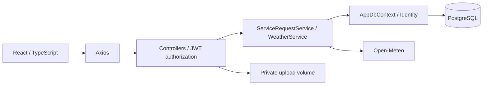
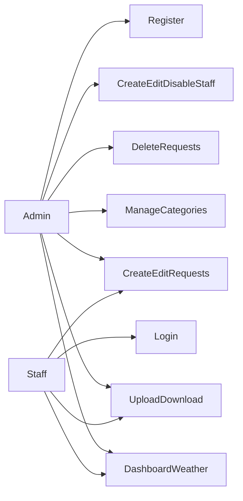
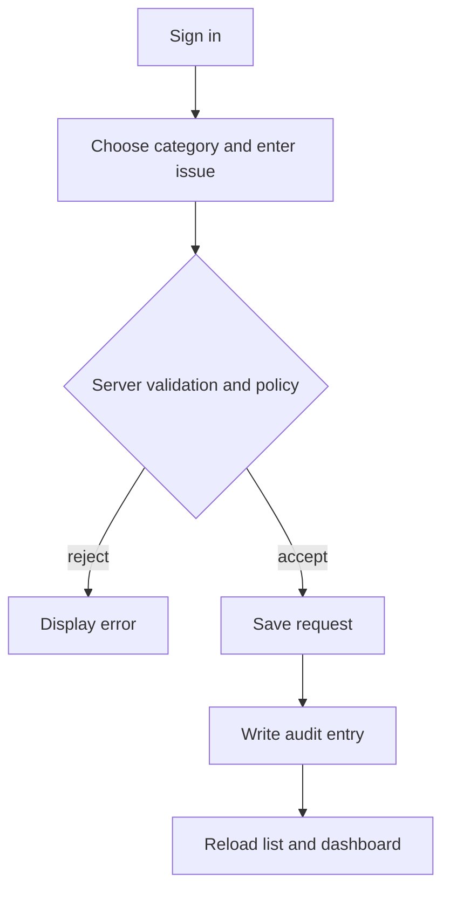
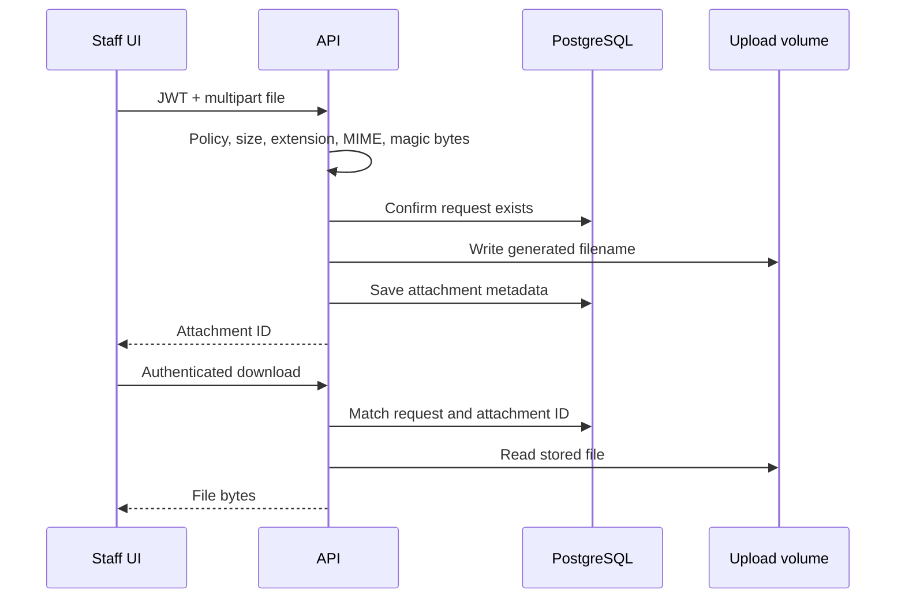
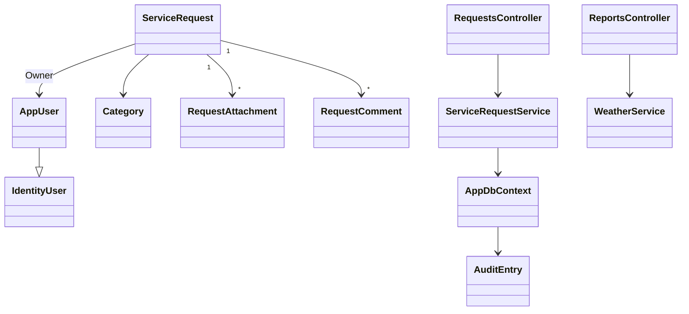
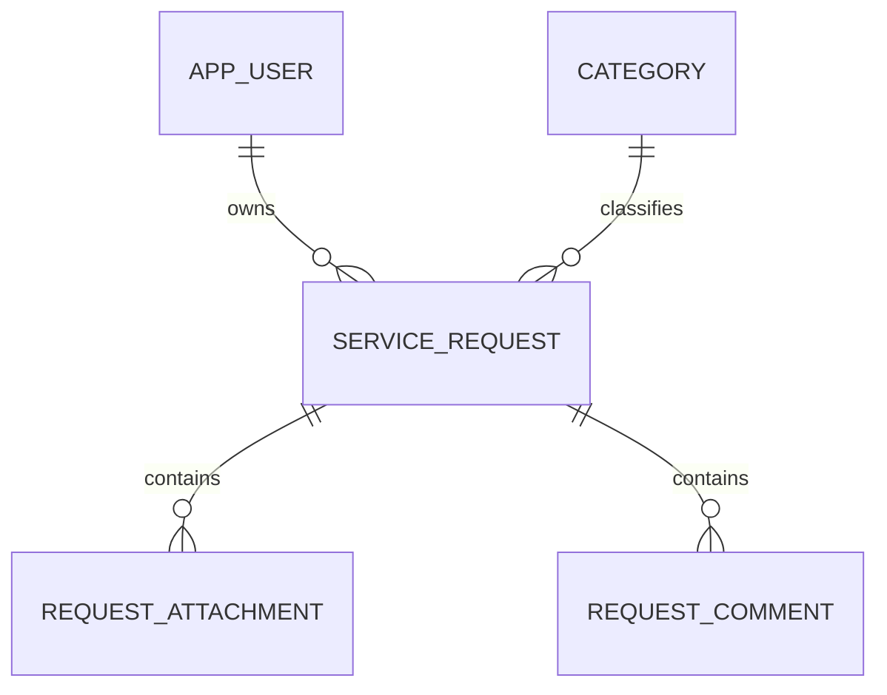

# Implementation documentation

## Overview and measurable scope
Campus IT Service Desk centralizes campus support requests, reducing lost reports and exposing pending/resolved work. Staff and Admin are the target roles. SDG 4: reliable educational facilities; SDG 9: dependable campus infrastructure. Acceptance criteria: Admin registration (maximum two), Admin-created Staff, and login return usable accounts and JWTs; valid requests survive a separate HTTP read; admin categories support CRUD and reject deletion when referenced; authenticated file upload/download preserves bytes; dashboard totals reflect persisted tickets; invalid upstream weather returns a fallback.

## Layered architecture

Dependency injection supplies DbContext, services, Identity and HttpClient. Controllers validate transport input and permissions, services coordinate ticket behavior, EF maps relational state. React never connects directly to PostgreSQL.

## Use cases

## Activity: ticket submission

## Sequence: authenticated upload

## Class model

## ERD and normalization

Seven domain entities plus Identity role/claim/login/token tables exceed the five-entity requirement. Atomic fields satisfy 1NF; integer or Identity primary keys avoid partial dependencies (2NF); category names, users, comments and attachments live in their own relations rather than repeated columns (3NF). AuditEntry deliberately stores historical entity IDs without a cascading FK so deletion history remains.

## Data dictionary
- AppUser: Identity string ID, unique normalized email, hashed password, DisplayName up to 100, IsActive (default true).
- Category: int ID, unique required Name up to 80; delete restricted while tickets reference it.
- ServiceRequest: int ID, RequesterName 120, Issue 1200, Location 150, Status 30, UTC DateReported, CategoryId FK, nullable OwnerId FK (set null on user deletion).
- RequestAttachment: int ID, request FK with cascade, OriginalName and StoredName 255, ContentType 100, Size bigint, UTC UploadedAt.
- RequestComment: int ID, request FK with cascade, Body 1500, UTC CreatedAt. Reserved persistence model; comment UI/API is outside current scope.
- AuditEntry: int ID, Action/EntityName 100, EntityId int, UTC OccurredAt.

InitialCreate creates Identity and the six original domain tables, indexes and relationships. StaffAccountStatus adds IsActive with default true for existing users. App startup applies committed migrations and creates the Admin/Staff roles only. `--seed-demo` inserts two synthetic requests only when none exist. Demo seeding is optional and idempotent. Credentials are never seeded. See README for exact setup and operator commands.

## API inventory and user guide
Swagger at http://localhost:8080/swagger describes request schemas and bearer authentication.
- GET /api/auth/registration-status: public Admin count and availability. POST /api/auth/register: public Admin registration until two exist; POST /api/auth/login: public JWT login.
- GET /api/requests and /api/requests/{id}: authenticated list/detail.
- POST /api/requests and PUT /api/requests/{id}: CanManageRequests policy (Staff or Admin).
- DELETE /api/requests/{id}: Admin.
- GET /api/categories and /api/categories/{id}: authenticated.
- POST /api/categories, PUT/DELETE /api/categories/{id}: Admin; referenced deletion returns 409.
- POST/GET /api/requests/{requestId}/attachments: policy-protected upload/list.
- GET /api/requests/{requestId}/attachments/{id}: policy-protected download.
- GET /api/dashboard and /api/weather: authenticated report/weather.
- GET /health: public process liveness.

Register an Admin (maximum two), sign in, create Staff from Staff management, select a category, enter a synthetic name/issue/location and create a ticket. Edit changes its status. Open Attachments to upload/download PNG, JPG or PDF. Admin accounts see category controls and ticket deletion. Dashboard refreshes after CRUD. Sign out clears browser session state. Verified browser screenshots are in docs/evidence: dashboard-resolved.png and ticket-workflow.png. A synthetic staff account created a ticket and changed it to Resolved; the database-backed counts changed from pending 2 to pending 1/resolved 1. Live Open-Meteo data loaded and no browser console errors were recorded.

## Security self-assessment
A01 access control: server roles/policy, 401 anonymous and 403 Staff tests. Shared staff workspace intentionally permits all staff to view/update all tickets; private per-user tickets require additional authorization.
A02 cryptography: Identity hashing and HMAC JWT, two-hour lifetime, 32-byte minimum key. HTTPS and key rotation remain deployment duties.
A03 injection: EF parameterized queries, DTO length/required annotations; no raw user SQL.
A04 design: public registration creates at most two Admins. A PostgreSQL transaction/advisory lock serializes signup and operator provisioning. Only Admin can create Staff; roles cannot be supplied by the client. The initial two Admin slots must be claimed by trusted operators before publishing the app.
A05 configuration: secrets are environment-only; explicit CORS origins; safe exception responses. Public Swagger and liveness are intentional for evaluation.
A06 components: lockfile and .NET package versions; npm audit result in verification report. No claim of a complete supply-chain audit.
A07 authentication: Identity password rules and failed-password lockout tracking. Disabled Staff cannot log in; every authenticated request rechecks IsActive so existing tokens stop working. MFA, email verification and rate limiting remain future work.
A08 integrity: generated storage filenames, content signatures, CI build/tests. File signatures are not malware scanning.
A09 monitoring: persistent ticket audit actions. Central alerts, actor IDs, atomic ticket/audit writes and log retention remain future work.
A10 SSRF: fixed server-side Open-Meteo URL, timeout, bounded temperature and malformed-response fallback.

Privacy approach: demonstrations use synthetic data, minimal requester detail and no real personal records. Operators must define consent, retention, data access/deletion and controller responsibilities before collecting real data. This is an implementation statement, not legal certification.

## Testing and debugging
Unit suite covers status/category/required-field rules, upload metadata and signatures, temperature bounds, malformed and failed weather responses. HTTP tests cover middleware, anonymous 401, Staff 403, real registration/JWT, persisted CRUD on both entities, category FK conflict, upload/download and database dashboard. Coverage is collected by coverlet; unexecuted paths are not claimed covered.

D-01: startup called MigrateAsync with no migration. Root cause: starter shipped a placeholder. Fix: generated InitialCreate and model snapshot with EF 9.0.9; runtime empty-database evidence belongs in verification report.
D-02: admin-only workflows were unreachable. Root cause: registration only creates Staff and no provisioning implementation. Fix: explicit --provision-admin operator path; no hard-coded admin credentials.
D-03: frontend failed TS2339 on import.meta.env. Root cause: no Vite ambient types. Fix: vite-env.d.ts; production build passes.
D-04: malformed upstream JSON could escape fallback. Root cause: unexpected property type throws InvalidOperationException. Fix: safe fallback plus unit cases for null/string/invalid values.
D-05: upload trusted MIME text. Root cause: extension/MIME checks alone. Fix: PNG/JPEG/PDF magic bytes plus authenticated retrieval and negative unit cases.

## Deployment, limitations and team evidence
README contains container setup, local tests, migration commands and restart procedure. No repository remote, public URL, TLS host, passing GitHub status, protected main, release tag or backup recording is asserted. A provider-specific wake-up procedure requires an actual host. Team members must supply proposal approval, midterm evidence, four real sprint records, eight meaningful commits and two reviewed PRs per member, signed contribution matrix, defense and recording. See TEAM_RECORDS.md. These records cannot be reconstructed honestly by generating fictional history.

Future work: trusted Admin bootstrap enrollment, access reviews, account lifecycle, scanning uploads, pagination, resilient atomic audit, centralized logging and retention, TLS-hosted deployment and browser end-to-end evidence. Filesystem cleanup occurs after ticket deletion; operational failures should be reconciled during maintenance.

AI declaration: ChatGPT generated the starter; Codex reviewed source and requirements, repaired implementation, added tests/configuration and prepared this documentation. Measured verification is recorded in VERIFICATION.md. Human team review, personal contribution attribution and signatures are outstanding. Third-party credits are listed in README; library licenses remain with their respective authors.

D-06: HTTP ticket detail returned 500 after EF navigation fix-up formed Category.Requests cycles. Fix: JSON-ignore reverse navigation collections; full persisted CRUD integration now passes. D-07: parallel WebApplicationFactory instances raced creating roles in one database. Fix: serialize integration test collections; the full suite now passes.

## Admin bootstrap and Staff management
Public registration remains available after the first Admin is created. Each registration returns to sign-in without creating a session. After the second Admin exists, sign-in displays the maximum-two notice and hides registration. Counts come from PostgreSQL on page load and browser focus; logout mounts a fresh login screen. Direct third registrations return 409. Failed registrations roll back without consuming a slot.

Admin-only endpoints: GET /api/staff lists safe profile fields; POST /api/staff creates a Staff-only account using Identity password validation; PUT /api/staff/{id} edits display name/email and enabled status. The routes never modify Admin accounts and return 401 for anonymous and 403 for Staff. Password hashes are never returned. Staff have no Staff management panel. Disabling Staff immediately invalidates access; enabling permits login again.

## Navigation and account-deletion update (1 November 2026)
The interface now has separate hash-addressed pages and a responsive sidebar. The overview loads reports and weather independently. Requests have search/status filters and focused create/edit/file dialogs. Categories and Staff management are Admin-only pages. Settings exposes account details, browser-persistent light/dark appearance, and role-appropriate account deletion controls.

AccountDeletionRequest is the seventh domain entity: Id, nullable UserId/ReviewedById, Reason (500), Status (20), RequestedAt and nullable ReviewedAt. Both user relationships use SET NULL. A unique filtered index permits only one Pending request per user. AccountDeletionRequests is the third committed migration.

GET /api/account/me exposes safe profile/deletion state. DELETE /api/account requires Admin and current password; the last active Admin is protected. POST/DELETE /api/account/deletion-request submits/cancels a Staff request. GET /api/account/deletion-requests and POST /api/account/deletion-requests/{id}/review require Admin. Staff approvals cannot remove an Admin, including a Staff member promoted after requesting deletion. Concurrent deletion, registration and provisioning share the same transaction/advisory lock. Identity account removal immediately blocks old tokens, while ticket owner references are cleared and service history/files retained.

Latest automated and browser evidence: docs/evidence/navigation. See PAGES_AND_SETTINGS.md and VERIFICATION.md; earlier screenshots and test files document previous releases.

## Configurable weather and forecast update
WeatherService now uses selected, bounded coordinates with Open-Meteo current conditions, humidity/wind/feels-like, WMO labels and three daily forecasts. Authenticated GET /api/weather supports latitude/longitude pairs; GET /api/weather/locations searches cities through the fixed geocoding host. Inputs and provider responses are validated and upstream timeout/failure remains safe. Settings stores approximate location in a versioned, account-keyed browser preference. Browser device location is requested only on the user button; there is no background tracking. No schema change was needed. Current manual and automated evidence is in docs/evidence/weather.
