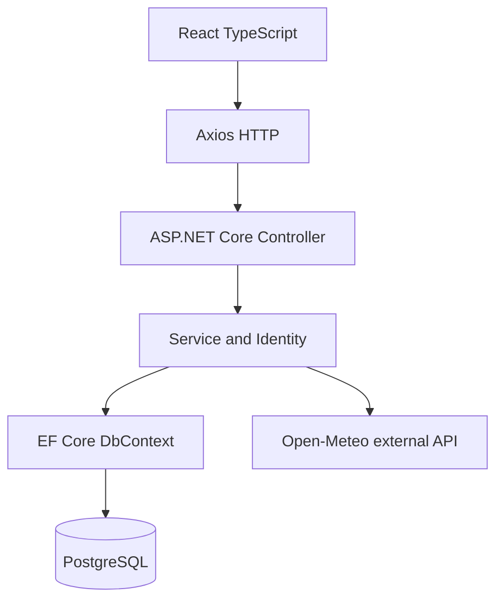
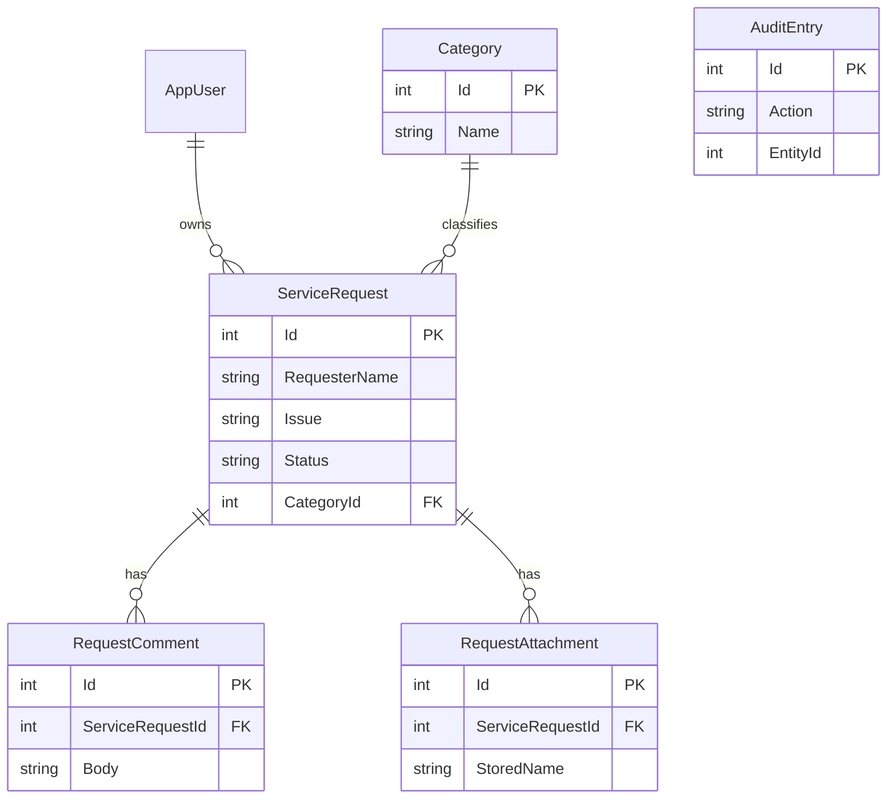
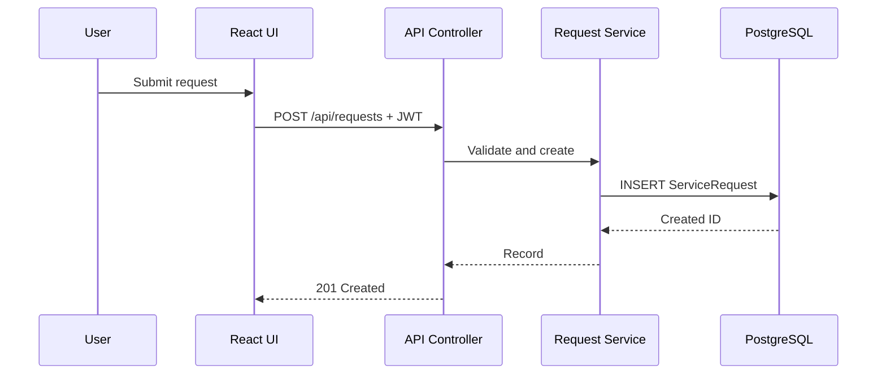
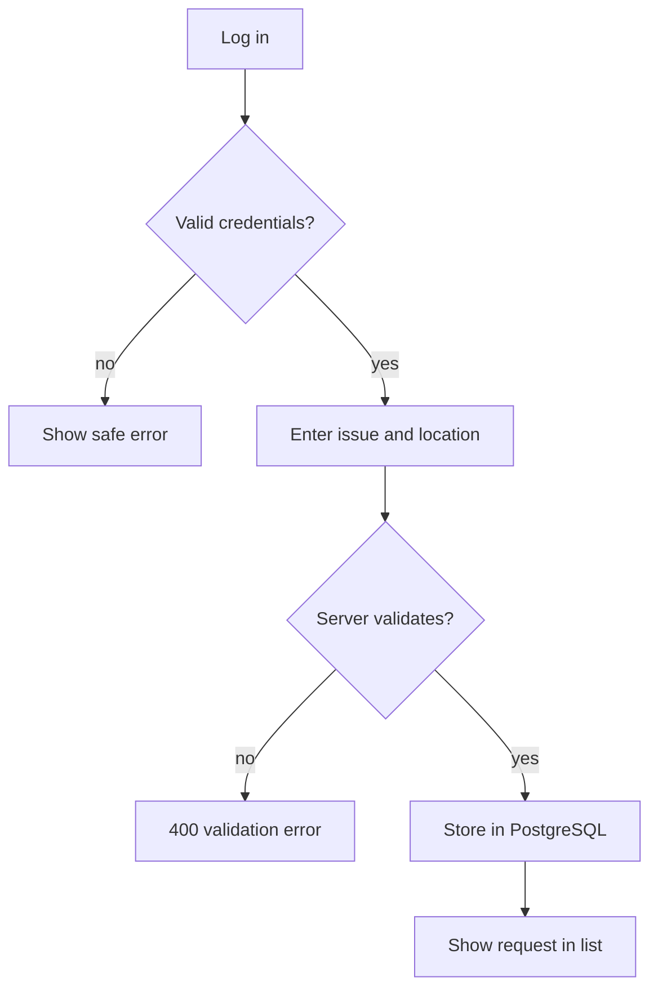
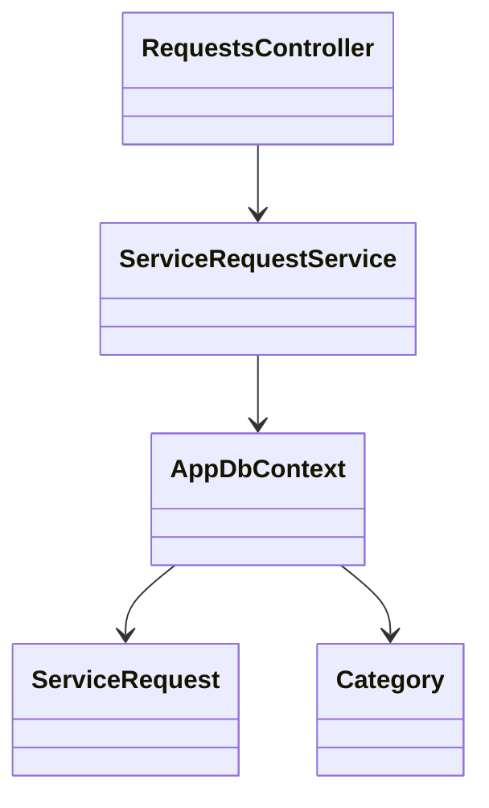

# Project scope and traceability
Project: Campus IT Service Desk. Target users: campus IT employees (Staff) and IT supervisors (Admin). SDG 4: less disruption to learning from technical issues; SDG 9: more accountable campus IT operations.

## Use cases and acceptance criteria
| Workflow | Acceptance criterion |
|---|---|
| Authentication | Valid staff login returns signed JWT, invalid credentials 401, role permissions differ |
| Requests | Create/read/update ticket survives database restart; admin delete removes it |
| Categories | Admin can create/read/update/delete category; in-use category cannot be deleted |
| Evidence upload | Valid 5 MB or smaller PNG/JPEG/PDF accepted; other files rejected |
| Reports | Status bar chart reflects actual request counts after CRUD |
| External API | Server calls Open-Meteo with 4s timeout and safe fallback |

## Data dictionary / entities
1. AppUser (Identity user ID, display name, email, password hash)
2. Category (ID, unique name)
3. ServiceRequest (ID, requester, issue, location, status, date, category FK, owner FK)
4. RequestComment (ID, request FK, body, created timestamp)
5. RequestAttachment (ID, request FK, filename, storage key, type, size, timestamp)
6. AuditEntry (ID, action, entity name, entity ID, timestamp)
Identity's role tables provide RBAC. Individual attributes are atomic (1NF), entities have single-column keys with no partial dependencies (2NF), and category metadata is held in Category rather than repeated on requests (3NF).

## Diagrams (Mermaid source, usable in GitHub)
### Layers

### Entity relationship

### Sequence

### Activity

### Class model

### Use cases (textual model)
- Staff: register, log in, create/view/edit request, upload attachment, view dashboard
- Admin: all Staff actions plus delete request and CRUD category

## Decisions and known limitations
No real enrollment directory is connected; this service is a standalone campus-IT workflow. Admin provisioning is implemented as the explicit --provision-admin operator command. Public registration allows the first two Admins; only Admin can create Staff. Trusted operators must claim the two Admin slots before public deployment. Attachment metadata is kept in PostgreSQL and binary bytes in a named Docker volume. Upload validation checks size, extension, declared MIME and PNG/JPEG/PDF signatures. See `README.md` for execution limits.
