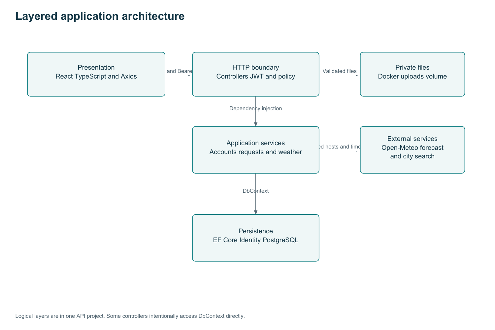
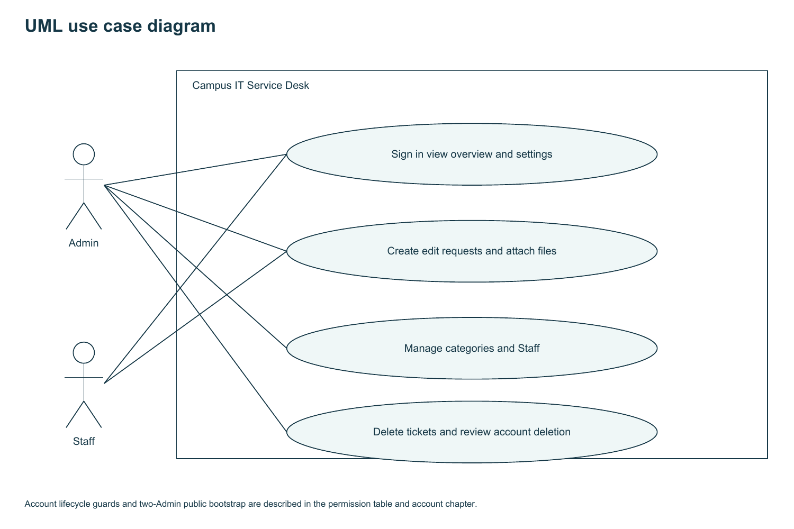
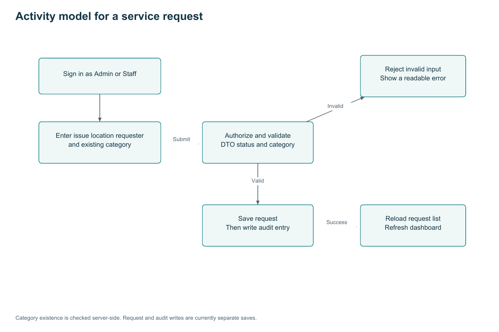
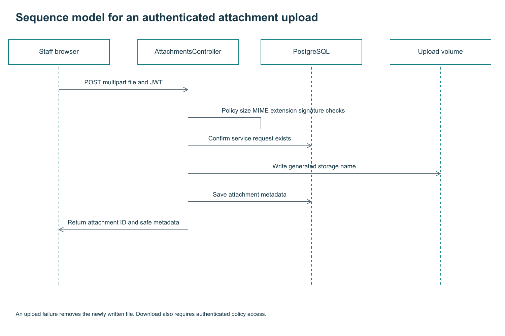
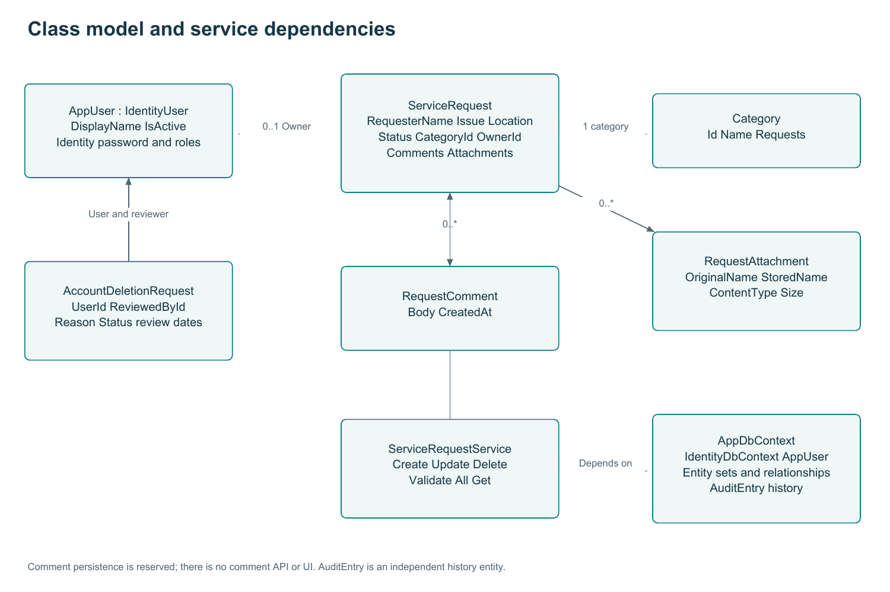
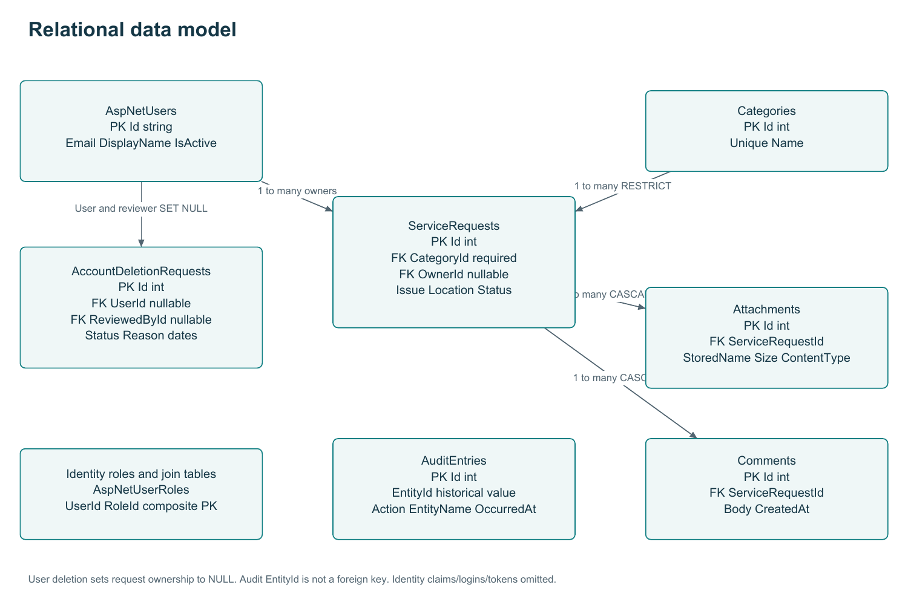
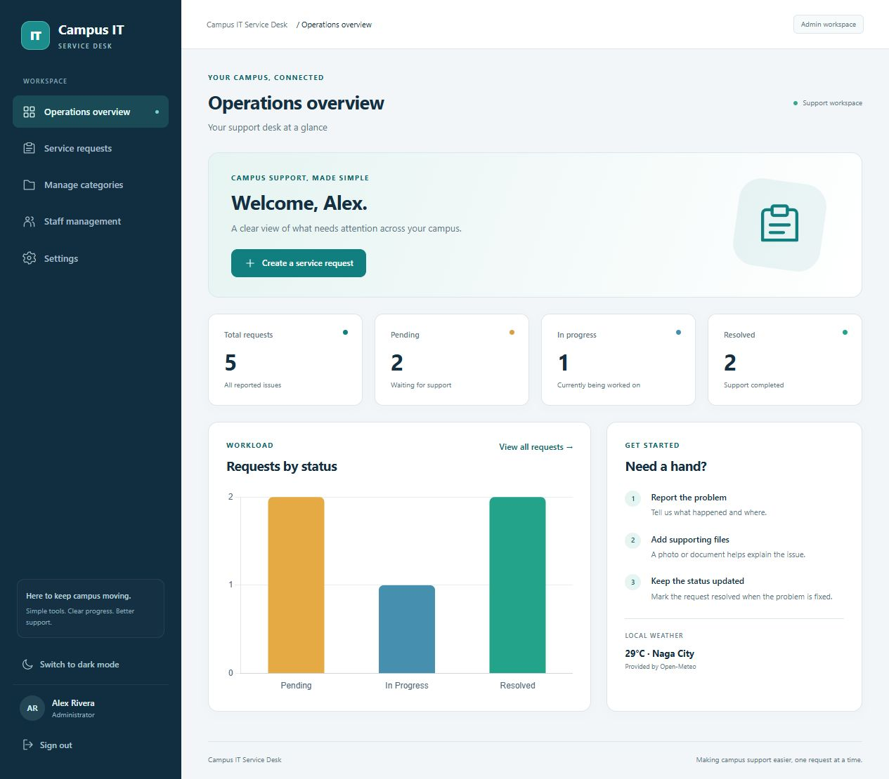
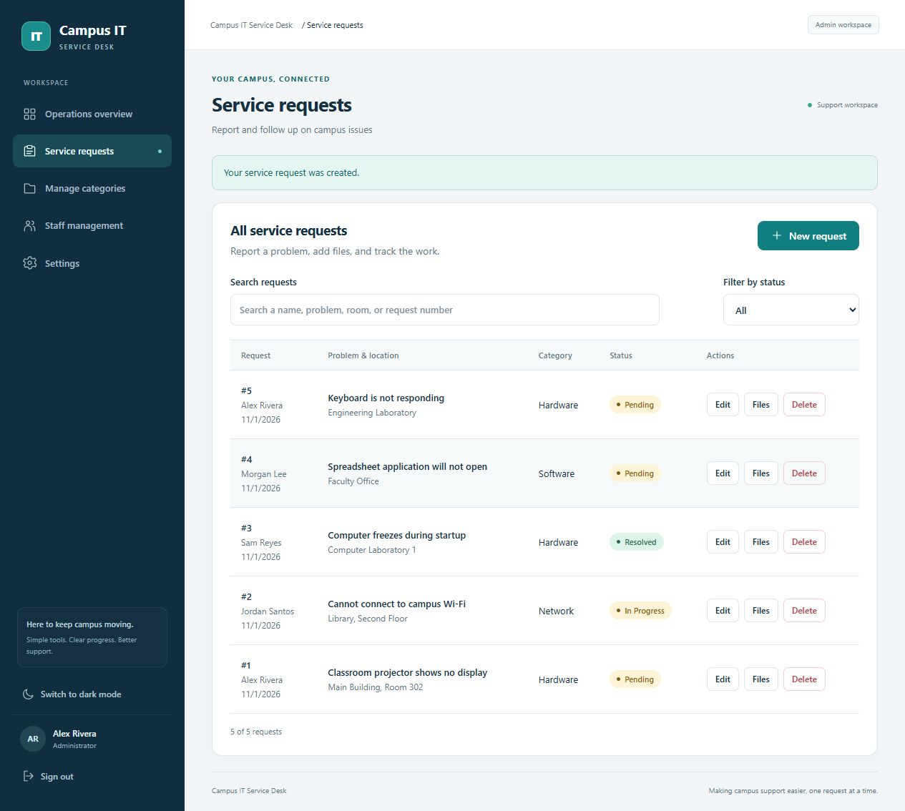
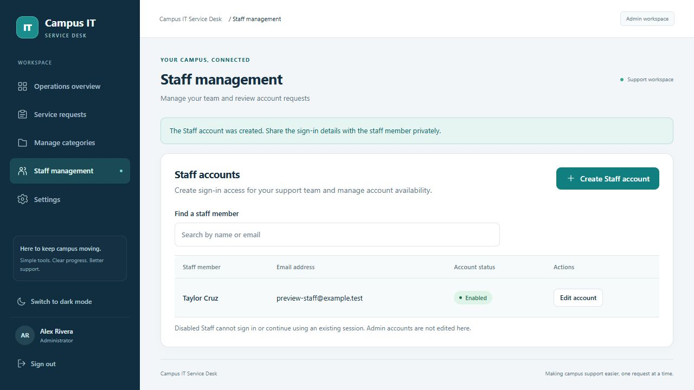
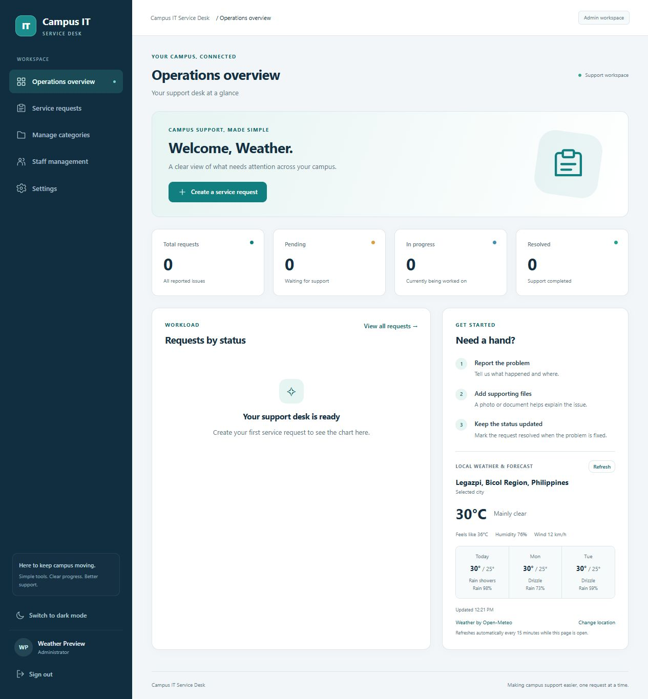

# Campus IT Service Desk

Integrative Programming 1 Final Project Documentation

Prepared for final submission review on 23 November 2026

## Submission identity

| Field | Complete before submission |
|---|---|
| Team name | group ni arjei |
| Members and student numbers | Eugene Ricafort; Arjei Lacayanga; John Lei Madrona; Student numbers: to be supplied |
| Course and section | Integrative Programming 1; section to be supplied |
| Instructor | Mark Boton |

## Project summary

Campus IT Service Desk is a working support workspace for campus IT personnel. Admins and Staff record equipment, software and network problems, update progress, attach supporting files and view database-backed summaries. It integrates React, an ASP.NET Core API, EF Core and PostgreSQL.

This document describes the implemented source and recorded verification. The supplied team is group ni arjei: Eugene Ricafort, Arjei Lacayanga and John Lei Madrona, under Mark Boton. Signatures, prior approvals, sprint records, hosted URL and backup video still require real evidence. The public source repository is https://github.com/microwaveTuesday/campus-it-service-desk.

Source baseline reviewed: ef58d9566f55b86b5d6114c7cd10f8c3cb2f8b6b. Latest recorded automated evidence: 116 passing tests. No new execution of the full suite is claimed on the preparation date.

# Document guide and submission status

The report covers the problem and acceptance criteria, architecture and UML, normalized data model, stack and setup, API and user workflows, security, tests and defects, deployment, team evidence and credits. Supporting scripts and editable forms are included in the submission kit.

| Item | Verified or remaining |
|---|---|
| Source and Docker | Existing GitHub main at ef58d95; both CI jobs passed. |
| Tests | 116 passed on 1 November 2026; TRX and coverage included. |
| Documentation | Prepared against Sections 6.1 and 11 of the original guidelines. |
| Team identity and contributions | Names, signatures, actual commit and PR references needed. |
| Process evidence | Four genuine one-week sprint records and prior approvals needed. |
| Hosting and video | Public app URL and a real recorded walkthrough up to 10 minutes needed. |
| Repository controls | main is not protected; no release and no PRs found on 23 November. |

The GitHub repository is public as checked on 23 November. Repository visibility may change. Repository access alone is not a public deployment of the application.

Preparation does not establish proposal approval, the midterm grade, historical sprint activity or individual student authorship. Complete the provided forms with real dates and evidence.

# Problem purpose and community benefit

## Problem and target users

Campus support reports can become difficult to follow when they are scattered across informal messages or verbal requests. A shared ticket record gives IT personnel one place to see what happened, where it happened and whether support is still pending.

The direct users are authorized campus IT Admins and Staff. Students, teachers and office personnel benefit indirectly when staff record and resolve the problems affecting their work. Requester names describe people needing support; they are not a third login role in the current application.

## Objectives and expected benefits

Provide a persistent record for each reported issue, organize requests into categories, track Pending, In Progress and Resolved states, and make supporting files available to authenticated personnel. Admin controls support account management while the overview summarizes the shared workload.

Expected community benefits include fewer misplaced reports, clearer handovers between support personnel and better visibility of unresolved classroom or office issues. These are intended benefits. No field study has measured reduced response time or improved satisfaction.

## SDG alignment

The project is aligned in purpose with SDG 4 through support for usable educational facilities and SDG 9 through maintenance of campus digital infrastructure. This is a project-level rationale, not evidence of measured SDG impact. Weather is supplementary campus context and satisfies the external-service integration requirement; it does not predict outages or prioritize tickets.

# Scope and measurable features

| Workflow | Acceptance criterion |
|---|---|
| W1 Accounts | Up to two Admins can register; a third receives 409. Only Admin creates Staff. Anonymous access receives 401; forbidden Staff actions receive 403. |
| W2 Requests | A valid ticket persists and can be read and edited. Admin can delete it. Invalid category or status is rejected. |
| W3 Categories | Admin can create, read, rename and delete an unused category. A category referenced by a ticket returns 409 on deletion. |
| W4 Files | Authenticated users upload PNG, JPG or PDF up to 5 MiB with matching signature and download the stored bytes. |
| W5 Overview | Counts and chart reflect persisted tickets by status and category. Empty startup has zero categories and requests. |
| W6 Account lifecycle | Last active Admin cannot self-delete. Staff deletion needs an Admin review; removed users lose access. |
| W7 Weather | Authenticated location search and current/three-day forecast use bounded coordinates, fixed upstream hosts, timeout and fallback. |

## Scope boundaries

All authenticated Staff share the request workspace and can edit its requests. There is no student self-service portal, technician assignment, email delivery, inventory module or SLA engine. Comments have a persistence model but no UI/API. Appearance and weather preferences are saved in the current browser.

# Layered architecture

React renders pages and calls JSON endpoints through Axios. JWT middleware checks issuer, audience, signature and lifetime. Authorization runs before protected actions. Services coordinate account rules, request changes and external weather calls. EF Core maps application and Identity state to PostgreSQL.

Dependency injection supplies scoped services, Identity, DbContext and the typed HttpClient. The API is a single project with logical layers, not separate deployable domain services. Category, report and account controllers also access DbContext directly. Files live in a persistent volume; only metadata is stored in PostgreSQL.

# Use case model and permissions

| Capability | Admin | Staff |
|---|---|---|
| View overview and requests | Yes | Yes |
| Create and edit requests; attachments | Yes | Yes |
| Delete requests; category mutations | Yes | No |
| Create edit or disable Staff | Yes | No |
| Review Staff deletion requests | Yes | No |
| Delete own account | If another active Admin remains | Request approval |

# Activity model

A user chooses an existing category and supplies a requester name, issue, location and status. Client guidance improves usability, but server validation and category checks remain authoritative. A successful change refreshes the list; the overview loads aggregate counts from the database.

The current request service saves the ticket and audit in separate operations. If audit persistence fails after a successful ticket save, the client can receive an error even though the ticket exists. Atomic audit writes are a documented improvement.

# Sequence model

Attachment downloads repeat authentication and the CanManageRequests policy, match both the request ID and attachment ID, and return the original safe download name. Direct static access to the upload volume is not exposed.

Type checks combine an extension allowlist, declared MIME type, length and leading content bytes. They reduce invalid uploads but do not replace malware scanning or a complete file parser.

# Class model

AppUser extends IdentityUser. ServiceRequest owns comment and attachment collections and relates to Category and an optional AppUser owner. AccountDeletionRequest references the requesting user and reviewing Admin. ServiceRequestService performs request validation and mutations. AppDbContext inherits the Identity model and configures indexes and delete behavior.

# Normalized entity relationship model

## Normalization rationale

1NF: each field holds one value and repeating comments/files have separate rows. 2NF: application entities use single-column keys; the Identity user-role join has a composite key with no unrelated attributes. 3NF: category names and user details remain in their own tables rather than repeating on each request. Attachment metadata depends on its attachment key.

RequesterName is an intentional historical text snapshot, not a requester profile foreign key. Audit EntityId identifies a historical object and intentionally has no cascading relationship. The model is designed for 3NF under these business meanings.

# Data dictionary

| Entity and key | Important columns and rules |
|---|---|
| AppUser / AspNetUsers; Id string | Identity fields, DisplayName varchar max 100, IsActive boolean default true. Identity hashes passwords. Unique normalized usernames and configured unique email validation. |
| Category; Id integer | Name required max 80, unique index. Referenced category deletion is restricted. |
| ServiceRequest; Id integer | RequesterName required max 120; Issue required max 1200; Location required max 150; Status max 30; DateReported UTC. CategoryId required FK; OwnerId nullable FK with SET NULL. |
| RequestAttachment / Attachments; Id integer | ServiceRequestId required FK; OriginalName and StoredName max 255; ContentType max 100; Size bigint; UploadedAt UTC. Request deletion cascades metadata. |
| RequestComment / Comments; Id integer | ServiceRequestId FK; Body required max 1500; CreatedAt UTC. Reserved model, no current comment screens. |
| AuditEntry / AuditEntries; Id integer | Action and EntityName max 100; EntityId integer; OccurredAt UTC. No actor identifier in the current schema. |
| AccountDeletionRequest; Id integer | Nullable UserId and ReviewedById FKs SET NULL. Reason max 500; Status max 20; RequestedAt and nullable ReviewedAt. Unique filtered pending request per UserId. |

Identity also stores roles, user-role memberships, claims, external login data and tokens in framework tables. Domain foreign keys, indexes and lengths are recorded in committed EF migrations.

# Migrations seeds and configuration

| Migration | Purpose |
|---|---|
| 20261029080237_InitialCreate | Initial domain and Identity tables, relationships and indexes. |
| 20261029085406_StaffAccountStatus | Adds IsActive with default true, retaining existing users. |
| 20261101002832_AccountDeletionRequests | Adds deletion requests, nullable user/reviewer relations and pending-request index. |

Startup calls MigrateAsync and ensures Admin and Staff roles. It does not create credentials, categories, requests or Staff. CleanStartupTests verifies an empty workspace and idempotent demo seeding on an isolated PostgreSQL database.

## Optional synthetic demonstration data

docker compose -p campusitcapstone run --rm api --seed-demo

The explicit demo command inserts Network, Hardware and Software categories if none exist and two synthetic requests if the request table is empty. It does not create users. It is optional; keep the live workspace empty by not running it.

## Configuration

scripts/initialize.ps1 creates random database/JWT secrets in a local .env only when that file is absent. .env.example is safe configuration guidance. Never overwrite a working .env or submit the real file. PostgreSQL pgdata and the uploads volume are outside the source archive.

# Technology stack and setup

| Component | Declared or locked version |
|---|---|
| .NET / EF Core | Target net9.0; SDK 9.0.320 with latestPatch; EF/JWT/Identity packages 9.0.9 |
| PostgreSQL provider | Npgsql.EntityFrameworkCore.PostgreSQL 9.0.4 |
| PostgreSQL / Node | PostgreSQL 16 container; Node 22 in CI and frontend build |
| React / TypeScript | 18.3.1 / 5.6.3 |
| Axios / Vite | 1.21.0 / 6.4.5 |
| Charts / Swagger | Chart.js 4.6.1; Swashbuckle 9.0.6 |
| Tests | xUnit, WebApplicationFactory and coverlet; exact package versions in tests/CampusIT.Tests.csproj |

## First run on Windows

Install/start Docker Desktop with its Linux engine running. Extract the source ZIP, open the CampusITCapstone folder in VS Code and use its PowerShell terminal. Internet is needed for the first image build.

.\scripts\initialize.ps1
docker compose -p campusitcapstone up --build -d

Open http://localhost:3000. Register a trusted first Admin and sign in. Add a category and create synthetic Staff only when needed for a demonstration. Fresh installations have no accounts or categories. Existing local users retain credentials in their Docker volume.

If PowerShell execution policy blocks initialization, generate secrets through an allowed organization-approved method. RUN_SYSTEM.md contains the full operating instructions.

# API inventory for accounts

Swagger/OpenAPI: http://localhost:8080/swagger while the local API runs. The hosted equivalent depends on the eventual deployment. Bearer JWT authentication is configured in Swagger.

| Method and path | Access and purpose |
|---|---|
| GET /api/auth/registration-status | Public. Count and availability of the two Admin slots. |
| POST /api/auth/register | Public until limit. Creates Admin, returns to login; 409 when full. |
| POST /api/auth/login | Public. Identity password check; returns token and roles. |
| GET /api/staff | Admin. Safe Staff profile list. |
| POST /api/staff | Admin. Create a Staff-only account. |
| PUT /api/staff/{id} | Admin. Edit name/email and active status; not Admin accounts. |
| GET /api/account/me | Authenticated. Profile, role and deletion state. |
| DELETE /api/account | Admin and current password. Refuses last active Admin deletion. |
| POST /api/account/deletion-request | Staff and password. Request deletion; one pending request. |
| DELETE /api/account/deletion-request | Staff. Cancel pending deletion request. |
| GET /api/account/deletion-requests | Admin. Pending Staff deletion requests. |
| POST /api/account/deletion-requests/{id}/review | Admin. Approve or decline once. |

Only minimal safe fields are returned. Account deletion does not erase ticket history or uploaded attachments; request OwnerId becomes NULL.

# API inventory for support and reports

| Method and path | Access and purpose |
|---|---|
| GET /api/requests; GET /api/requests/{id} | Authenticated list/detail. |
| POST /api/requests; PUT /api/requests/{id} | CanManageRequests policy: Admin or Staff. |
| DELETE /api/requests/{id} | Admin. Delete request, related metadata and stored files. |
| GET /api/categories; GET /api/categories/{id} | Authenticated list/detail. |
| POST /api/categories; PUT /api/categories/{id} | Admin. Create/update unique category. |
| DELETE /api/categories/{id} | Admin. 409 if in use. |
| POST /api/requests/{requestId}/attachments | Admin/Staff policy. Multipart file upload. |
| GET /api/requests/{requestId}/attachments | Admin/Staff policy. Safe attachment metadata. |
| GET /api/requests/{requestId}/attachments/{id} | Admin/Staff policy. Download matching stored file. |
| GET /api/dashboard | Authenticated database aggregates by status/category. |
| GET /api/weather | Authenticated current conditions and forecast; optional latitude/longitude pair. |
| GET /api/weather/locations?query=... | Authenticated city search, 2 to 100 characters. |
| GET /health | Public process liveness, not a full database readiness check. |

## Transport and validation

Requests use JSON, except multipart attachments. DTO attributes bound lengths and required fields; request service checks allowed status and category. Common outcomes are 400 invalid input, 401 unauthenticated, 403 forbidden, 404 missing resource and 409 conflict. Swagger exposes the exact schemas.

# Overview and service request interface

Figure 1. Historical synthetic preview of the overview. The left sidebar opens individual workspaces. Summary totals and the status chart use database data. The create button starts a focused request form.

# Service request interface

Figure 2. Synthetic preview of Service requests. Search/status filters help staff find work. Editing updates the stored request; Attachments opens authenticated file actions. Admin also sees Delete. These screenshots document prior verification, not the present live contents.

# Admin and settings interface

Figure 3. Synthetic Staff management preview. Admin creates or updates Staff, controls access and reviews deletion requests. Staff cannot access this management page or its protected endpoints.

# Weather settings and forecast

Figure 4. Synthetic overview preview with a selected weather city and three-day forecast. In Settings, search/select a city or grant device location on an explicit click. The approximate location is saved per account in this browser.

# Security self assessment

This is a source-based educational self-assessment using the A01 to A10 labels already used in the project. It is not a penetration test or security certification. Controls and residual limitations are listed together.

| OWASP category | Project control and residual limitation |
|---|---|
| A01 Broken access control | Roles, CanManageRequests policy, active-user check and protected file download. Residual: shared ticket access is intentional; no per-requester privacy boundary. |
| A02 Cryptographic failures | Identity password hashing, HMAC JWT with 32-byte minimum key and expiry. Residual: local HTTP; hosted HTTPS and key rotation needed. |
| A03 Injection | EF parameterized data access, bounded DTOs and trimmed inputs. The raw account-lock SQL is a fixed constant without user interpolation. |
| A04 Insecure design | Two-Admin cap, transaction/advisory lock and last-active-Admin guard. Residual: trusted operators must claim bootstrap slots before public exposure. |
| A05 Security misconfiguration | Environment secrets, explicit CORS and problem responses. Swagger remains enabled intentionally for evaluation; production configuration needs review. |

# Security privacy and account lifecycle

| OWASP category | Project control and residual limitation |
|---|---|
| A06 Vulnerable components | Pinned .NET packages and npm lockfile. No current dependency vulnerability audit is claimed; review upgrades and advisories before public deployment. |
| A07 Identification and authentication | Identity password validation, failure tracking, two-hour JWT, disabled-user rejection on each request. Residual: no MFA, email verification or explicit rate limiting. |
| A08 Software and data integrity | CI builds/tests, generated storage filenames and extension/MIME/signature checks. Residual: no upload malware scanning or signed artifact verification. |
| A09 Logging and monitoring | Persistent request audit records. Residual: no actor IDs, centralized alerting, defined retention or atomic ticket/audit commit. |
| A10 Server-side request forgery | Fixed forecast/geocoding hosts, coordinate/query validation, four-second timeout and safe provider fallback. User cannot supply an upstream URL. |

## Privacy approach

The course requires a privacy approach under the Data Privacy Act of 2012 (RA 10173). Use synthetic requester names, accounts and files in demonstrations. Collect only the requester detail needed for a support report. Limit access to authorized personnel, avoid sensitive information in issue text/files, and define a retention and access/deletion process before real use. No legal compliance certification is claimed.

Device location is requested on a user action with browser permission and failure messages. Coordinates are rounded to two decimals before local storage/transmission. Weather preferences stay per account in browser storage and do not synchronize across devices. The provider receives the selected coordinates; there is no continuous GPS tracking.

Staff deletion needs current-password confirmation and Admin review. Admin self-deletion needs another active Admin. Tickets and attachments remain afterward; operators must consider that retained requester text can still contain personal information.

# Test plan results and coverage

## Test strategy

Unit tests cover service input rules, upload metadata/signatures, coordinate ranges, forecast parsing and upstream failure handling. HTTP integration tests use WebApplicationFactory and real PostgreSQL to exercise middleware, identity, authorization, CRUD, attachments, reports and account deletion. Isolated-account databases protect signup tests from shared state.

| Recorded evidence | Result |
|---|---|
| Local Linux/PostgreSQL suite, 1 November 2026 | 116 executed; 116 passed; 0 failed or skipped. |
| Unit and HTTP integration split | 65 unit cases and 51 integration cases; parameterized cases count separately. |
| Coverlet line coverage | 2573 of 2626 instrumented lines, 97.98%. |
| Coverlet branch coverage | 300 of 412 branches, 72.81%. |
| GitHub CI baseline | build-and-test and docker-smoke both successful. |
| Exact CI run | https://github.com/microwaveTuesday/campus-it-service-desk/actions/runs/41273684255 |

Coverage includes startup and generated migration code; these totals are not business-logic-only coverage. Raw TRX and Cobertura XML are in docs/evidence/clean-backup. Historical browser evidence is in docs/evidence/navigation and weather. The suite was not rerun on 23 November because the local Docker engine was stopped. CI results were rechecked on that date.

Remaining manual checks include actual device-location permission/accuracy, a full 15-minute refresh interval, real hosted deployment and the team live walkthrough. Test evidence demonstrates recorded behavior, not every possible fault.

# Test execution and manual acceptance

## Automated test execution

Use disposable PostgreSQL and a user allowed to create/drop isolated test databases. Configure ConnectionStrings__Default, Jwt__Key, Jwt__Issuer and Jwt__Audience in the test process. Never run integration tests against the application database.

dotnet test tests/CampusIT.Tests.csproj --collect:"XPlat Code Coverage" --logger trx
npm --prefix frontend ci
npm --prefix frontend run build

Alternatively use Dockerfile.tests on a disposable Compose network. CI provisions PostgreSQL 16, restores/builds .NET, runs tests, scans configured secret patterns and builds the frontend. A second job builds the full Compose stack and checks API/UI HTTP endpoints.

## Manual acceptance route

On an isolated demo installation: register Admin; create a category and Staff; sign in as Staff; create and edit a request; upload/download a synthetic file; confirm overview totals; verify Staff lacks management controls; return as Admin and check category conflicts and deletion approvals. Record actual result, tester, date and evidence in Manual_Test_Cases.csv.

A detailed checklist and safe recording instructions are in the Demo and Defense guide. Do not consume a remaining Admin signup slot or delete a real account just to rehearse.

# Debugging and root cause log

These defects are documented in the project work and source. They predate the initial GitHub backup, so separate historical fix commit links are unavailable. The relevant fixes coexist in baseline ef58d95; no per-defect authorship or invented commit history is claimed.

| Defect | Cause fix and retest |
|---|---|
| D01 Missing migration | Starter startup invoked migrations with no usable initial migration. Added InitialCreate and snapshot. Empty-database startup and CI Docker smoke now pass. |
| D02 Frontend build error | TS2339 on import.meta.env from missing Vite ambient types. Added vite-env.d.ts; frontend production build passes in CI. |
| D03 Invalid upstream response | Unexpected JSON value types could throw outside the weather fallback. Added response validation and malformed-value tests. |
| D04 Upload trust boundary | Extension/MIME declarations alone allowed mismatched content. Added leading-byte signature checks with positive/negative tests. |
| D05 Circular serialization | EF navigation fix-up linked Category.Requests back to ServiceRequest and caused a detail response failure. Ignored reverse navigations; persisted CRUD tests pass. |
| D06 Test concurrency | Parallel application factories raced role initialization against shared state. Serialized integration tests and isolated signup/deletion databases. |
| D07 Empty category reset | Normal startup repopulated categories after the user cleared them. Moved seeding to explicit demo command and added CleanStartupTests. |

Supporting sources: backend/Migrations, frontend/src/vite-env.d.ts, WeatherService, AttachmentsController, entity JsonIgnore annotations, tests/AssemblyInfo.cs, IsolatedAccountDatabase and CleanStartupTests.

# Deployment operation and recovery

## Local operation

docker compose -p campusitcapstone up -d
docker compose -p campusitcapstone ps
docker compose -p campusitcapstone logs --tail 80 api
docker compose -p campusitcapstone down

The normal down command retains pgdata and uploads. Reopen Docker Desktop and start the same Compose project to recover local service. Do not use down -v on an installation containing records you need.

## Docker engine and certificate problems

If dockerDesktopLinuxEngine or failed to connect to the docker API appears, open Docker Desktop and wait for Engine running. If package restoration fails only on an inspected network, use scripts/export-build-ca.ps1 and docker-compose.trust.yml with organization-trusted public CA certificates. Do not disable certificate verification or include local CA files in the submission.

## Public hosting plan and wake procedure

No public application URL is configured or verified. A deployment must run the frontend/API, supply trusted environment secrets, use persistent PostgreSQL/upload storage, set the actual allowed origin and provide HTTPS. Record the provider, application URL, health endpoint, owner and wake-up steps after deploying. localhost is not a public URL.

If hosting sleeps: open the provider dashboard, resume/wake its service, wait for database and API readiness, then load the public UI and perform login plus a read/write check. Replace these generic steps with provider-specific instructions once a host exists. Keep the real <=10-minute backup recording accessible during evaluation.

# User guide

| Task | Steps |
|---|---|
| First Admin | On a fresh installation register with a unique email and strong password, then sign in. At most two Admins can exist. |
| Categories first | Admin opens Manage categories and adds a meaningful support category before creating requests. |
| Create Staff | Admin opens Staff management, enters display name/email/initial password, then shares credentials privately. |
| Report a problem | Open Service requests, create a request, enter synthetic requester/issue/location and choose category/status. Save and confirm it appears. |
| Update work | Find the request with search/status filter, edit and change Pending to In Progress or Resolved. |
| Attach evidence | Use Attachments on a request. Upload a matching PNG/JPG/PDF <=5 MiB. Download to verify. |
| View progress | Open Operations overview for counts and chart. Figures reflect the shared database. |
| Settings | Choose light/dark appearance or a weather city. Device location asks browser permission after a click. |
| Staff deletion | In Settings confirm current password and send a deletion request. Admin approves or declines in Staff management. |
| Admin deletion | In Settings confirm password. The last active Admin cannot delete their own account. |
| Sign out | Use Sign out. Login returns and refreshes Admin registration availability. |

Readable validation/fallback messages help users recover. Staff should contact an Admin if no category exists or their account is disabled. Weather is supporting information and may be unavailable when the external provider cannot be reached.

# Agile backlog and actual records

The following backlog maps implemented work to measurable acceptance criteria. It organizes the project for review; it is not proof that a Scrum board or historical sprint took place.

| Backlog item | Scope and acceptance reference |
|---|---|
| B01 Trusted account setup | Admin cap and Staff enrollment; W1. |
| B02 Support requests | Persisted request CRUD/status and safe validation; W2. |
| B03 Categories | Admin CRUD and in-use deletion conflict; W3. |
| B04 Attachments | Authenticated validated upload/download; W4. |
| B05 Reporting | Database totals and chart; W5. |
| B06 Account lifecycle | Last Admin guard and reviewed Staff deletion; W6. |
| B07 Weather settings | City search, selected coordinates and safe fallback; W7. |
| B08 Delivery evidence | Tests/coverage, migrations, Docker, CI, report and real demo. |

## Records still required

The original guidelines require four one-week sprints with planning, review and retrospective notes, a Scrum board and actual contribution references. No actual sprint dates, board URL, teammate reviews or student ownership evidence were supplied. Use the four Sprint_Record templates in this kit to record genuine evidence. Do not backdate activities or populate attendance from guesses.

Week 4 proposal approval and Week 9 staging checkpoint must be attached from the actual course records. A new proposal draft is provided for review and cannot substitute for prior instructor approval.

# Team contributions and AI use

| Member | Role and module | Commits and reviewed PRs | Signature |
|---|---|---|---|
| Eugene Ricafort | ____________ | ____________ | ____________ |
| Arjei Lacayanga | ____________ | ____________ | ____________ |
| John Lei Madrona | ____________ | ____________ | ____________ |

The supplied roster contains three members. Confirm this team size with the instructor because the guidelines specify four to five. They also require at least eight meaningful commits and two teammate-reviewed pull requests per member. On 23 November the repository had the initial backup commit and no pull requests. This does not satisfy individual contribution evidence. If genuine work exists elsewhere, provide its real repository and references to the instructor.

## AI Use Declaration for team review

Tools used: OpenAI ChatGPT and Codex. Assistance included starter/source analysis, implementation repairs, migrations, account and interface features, tests, Docker/CI configuration, verification and preparation of documentation/presentation materials. Verification includes recorded unit/integration results, prior browser walkthroughs and a successful GitHub CI run. The current report was checked against the original final-project guidelines and source baseline.

Human responsibilities remaining: review code and documents, understand all submitted modules, verify personal contributions, complete missing deployment/team evidence and defend decisions independently. The team must disclose any additional tools or reused resources and approve/sign this declaration. No generated material establishes student authorship or completed historical activities.

Team confirmation and signatures: ____________________________________________________
Date: ____________________

# Limitations future work and references

## Known limitations and next steps

Public hosting, a real backup recording and genuine team/process evidence remain incomplete. Public bootstrap slots require trusted enrollment. Shared ticket access may need narrower authorization for real deployment. No MFA, password-reset UI, technician assignment, SLA reporting, comment UI or notifications are included. Request/audit saves are not atomic. Upload deletion can leave orphan files if filesystem cleanup fails.

Priorities for later work are trusted account invitations, production HTTPS and backups, access/retention review, atomic audit history, pagination, malware scanning and operational monitoring. A future hosted test should verify browser-to-API-to-database behavior and restart persistence.

## Sources and third party credits

Assignment authority: Integrative_Programming_1_Final_Project_Guidelines.pdf, Final Performance Task v2.0, especially Sections 5, 6 and 11. Implementation authority: the source baseline and package lockfiles in the GitHub repository. Existing starter: CampusIT_Capstone_Starter.zip. Diagrams in this report were prepared from the current code.

Libraries/services: React, TypeScript, Vite, Axios, Chart.js and react-chartjs-2; Microsoft ASP.NET Core, Identity, EF Core and JWT components; Npgsql, PostgreSQL, Swashbuckle; xUnit, WebApplicationFactory and coverlet; Docker and nginx; Open-Meteo forecast/geocoding services. OpenAI ChatGPT/Codex assistance is declared above. Each third-party component retains its own license.

Reference links: https://github.com/microwaveTuesday/campus-it-service-desk ; https://github.com/microwaveTuesday/campus-it-service-desk/actions/runs/41273684255 ; https://open-meteo.com/ ; https://react.dev/ ; https://learn.microsoft.com/aspnet/core/ ; https://www.postgresql.org/ . Version claims in this report come from project manifests/lockfiles, not from unverified current vendor release information.
