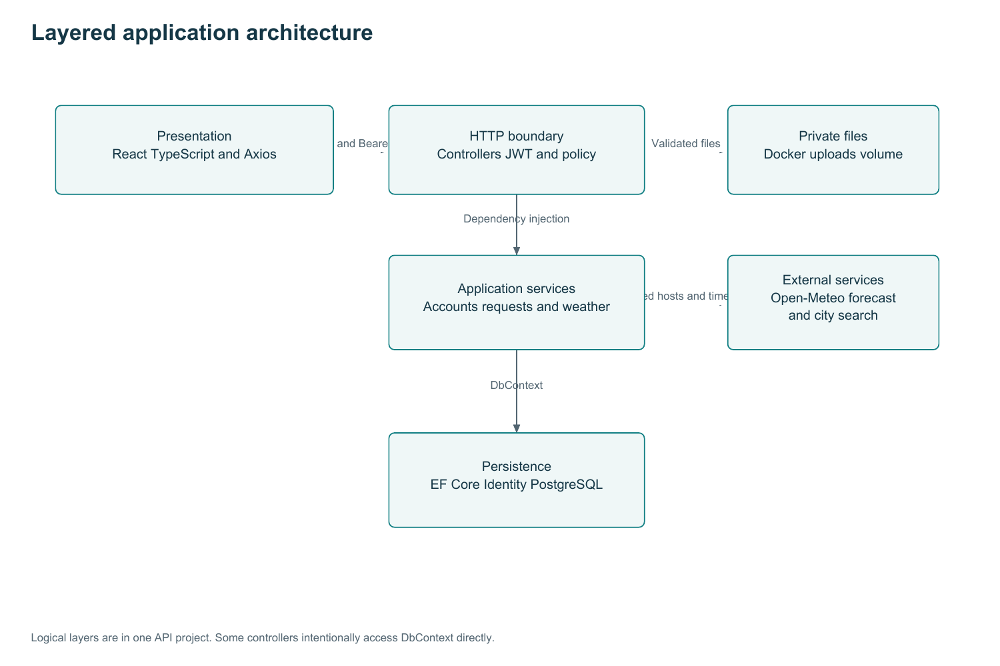

# Campus IT Service Desk Proposal

Current implementation baseline for instructor review. This draft does not establish Week 4 approval.

## Problem and users

Campus IT support reports can be scattered across informal channels, making unresolved work and handovers difficult to follow. Authorized IT Admins and Staff need one persistent workspace for issue details, location, category, attachments and status. Students, faculty and office personnel benefit indirectly through support operations.

## Objectives

Implement integrated account access, support request and category CRUD, authenticated file handling, workload reporting and an external weather service. Each flow must pass the acceptance criteria on the next page with real database persistence.

## SDG rationale

SDG 4 supports functioning educational facilities; SDG 9 supports campus digital infrastructure. The project aims to help support coordination. Impact has not yet been measured in a real deployment.

## Identity and approval

Team name: group ni arjei
Members: Eugene Ricafort, Arjei Lacayanga, John Lei Madrona
Course: Integrative Programming 1; section to be supplied
Instructor: Mark Boton
Approval decision and date: ____________________

# Scope features and acceptance

| Workflow | Proposed measurable acceptance |
|---|---|
| W1 Accounts | Up to two Admins can register; a third receives 409. Only Admin creates Staff. Anonymous access receives 401; forbidden Staff actions receive 403. |
| W2 Requests | A valid ticket persists and can be read and edited. Admin can delete it. Invalid category or status is rejected. |
| W3 Categories | Admin can create, read, rename and delete an unused category. A category referenced by a ticket returns 409 on deletion. |
| W4 Files | Authenticated users upload PNG, JPG or PDF up to 5 MiB with matching signature and download the stored bytes. |
| W5 Overview | Counts and chart reflect persisted tickets by status and category. Empty startup has zero categories and requests. |

Additional implemented scope includes reviewed account deletion, responsive separate pages, light/dark appearance, city selection and a three-day weather forecast. Comments, asset inventory, SLA automation, notifications and a student login portal are outside the current scope.

Evaluate using synthetic people/files only. A successful local demonstration is distinct from the required public deployment and prior midterm checkpoint.

# Architecture delivery risks and plan

Stack: React/TypeScript and Axios; ASP.NET Core Web API on .NET 9; EF Core and PostgreSQL 16; Identity/JWT with Admin and Staff roles; Docker Compose and GitHub Actions. No stack deviation is requested by this draft.

| Risk | Response |
|---|---|
| Unavailable hosting/network | Deploy and test a public URL; prepare a real <=10-minute backup recording. |
| Data privacy and unsafe bootstrap | Use synthetic demo records and trusted Admin signup; review access and retention before real data. |
| Scope or team evidence gaps | Use a real board, record four actual sprints, and link genuine per-member commits and PRs. |

Schedule: follow the course Week 4 approval, Week 9 checkpoint, Week 13 test evidence, Week 14 self-assessment, Week 15 CI, Week 16 freeze, Week 17 demo and Week 18 submission milestones. Actual dates and approval must come from the instructor.
